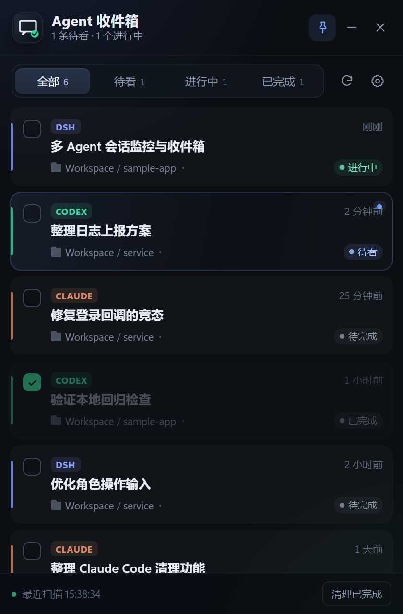
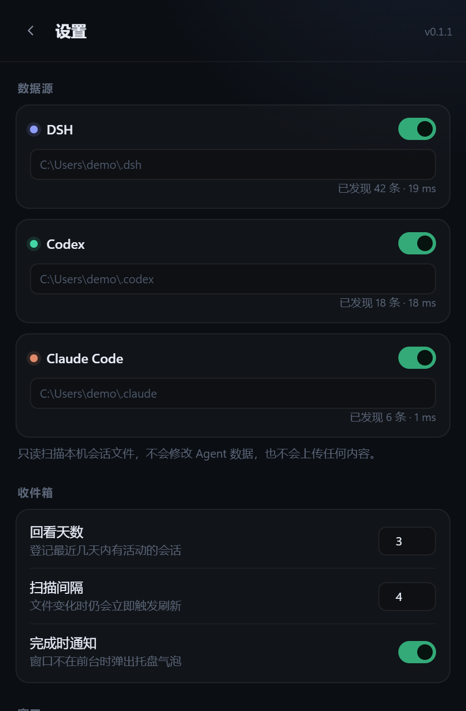

# Agent 收件箱（Agent Inbox）

一个只读、旁路的 Windows 桌面小工具：把本机 DSH、Codex、Claude Code 的会话汇总成一张收件箱列表，提示哪些对话刚跑完、哪些还没看过，并支持勾选完成和清理记录。



## 解决什么问题

同时开多个 Agent 时，真正麻烦的是：

- 某个 Agent 已经跑完，但没注意到；
- 不记得哪条对话看过、哪条还要跟进；
- 会话分散在不同应用里，缺少统一的“收件箱”。

这个工具不启动 Agent、不改 Agent 数据，只读取本地会话文件，提供一个托盘常驻的小窗。

## 功能

- 自动发现 DSH、Codex、Claude Code 会话，按最近活动登记；
- 列表展示标题、来源、项目目录、相对时间和状态（进行中 / 待看 / 待完成 / 已完成 / 已中断）；
- 检测一轮对话完成：新完成的记录置顶、标“待看”，窗口不在前台时弹托盘通知；
- 每条记录前的复选框：标记完成 / 取消完成，状态本地持久化；
- 点击记录把对应的应用窗口切到前台（DSH 的浏览器、Codex Desktop、Claude Code 所在的 VS Code/终端）；
- 清理已完成、清理全部；被清理的会话只有产生新的完成时才重新出现；
- 始终置顶、托盘菜单、单实例、开机自启（可选）、窗口位置记忆；
- 全程离线，不联网、不上传会话内容。

## 支持的数据源

| 来源 | 读取位置 | 标题 | 完成判定 |
|---|---|---|---|
| DSH | `~/.dsh/storages/session_projcache/sessions/*.json` | 投影缓存 `title` / 首条输入 | `sessionStats.openStep == null` 且无 pending 调用 |
| Codex | `~/.codex/sessions/**/rollout-*.jsonl` + `session_index.jsonl` | `thread_name`，回退首条用户消息 | 最后一个轮次标记是 `task_complete` |
| Claude Code | `~/.claude/projects/<project>/<sessionId>.jsonl` | 首条用户消息，回退 summary/last-prompt | `end_turn` / `last-prompt` / `cost-state` 收尾 |

细节与状态规则见 [需求文档](docs/requirements.md)；选型与 GitHub 调研见 [调研文档](docs/research.md)。

## 运行

### 直接运行

从 [Releases](https://github.com/Aptal/agent-inbox/releases/latest) 下载 `AgentInbox-v0.1.1-win-x64.zip`，解压后保持以下结构：

```text
AgentInbox.exe
ui\
```

双击 `AgentInbox.exe` 即可。首次启动会扫描 `%USERPROFILE%\.dsh`、`%USERPROFILE%\.codex`、`%USERPROFILE%\.claude`。

Windows 10 如果缺少 WebView2 Runtime，应用会提示安装；Windows 11 通常自带。

> 仓库只保存源码、文档和截图；构建产物在本地 `dist/`，不提交到 Git。

### 从源码构建

需要 .NET 10 SDK：

```powershell
dotnet build .\src\AgentInbox\AgentInbox.csproj -c Debug
dotnet publish .\src\AgentInbox\AgentInbox.csproj -c Release -r win-x64 --self-contained true `
  -p:PublishSingleFile=true -p:IncludeNativeLibrariesForSelfExtract=true `
  -o .\dist\AgentInbox
```

## 使用

- **看列表**：待看排最上面，进行中其次，已完成的排最后。
- **标记完成**：点记录左侧方框；再点一次取消。
- **跳转**：点记录主体，切到对应应用窗口；DSH 在浏览器标签页里时，会按标题匹配窗口。
- **清理**：底部“清理已完成”，或设置 → 数据 → “清理全部记录”。
- **托盘**：关闭窗口只是隐藏；托盘菜单可显示、置顶、刷新、退出。
- **设置**：数据源开关/路径、回看天数、扫描间隔、完成通知、置顶、开机自启。



## 状态与持久化

- 首次发现时，最近 2 小时内完成的会话会标为“待看”；更早的历史只登记为“待完成”，避免一次性刷出大量未读。
- 一轮对话完成且用户还没看过：`待看`。
- 点开记录：清除未读，变成 `待完成`。
- 勾选：`已完成`，写入 `%APPDATA%\AgentInbox\state.json`。
- 清理：写入隐藏墓碑；同一会话出现新的 `completionKey` 时自动恢复。
- 应用不保存对话正文，只保存标题、路径、状态和时间。

## 数据与隐私

- 只读扫描，不修改 `~/.dsh`、`~/.codex`、`~/.claude`；
- 无网络请求、无遥测；
- 状态文件：`%APPDATA%\AgentInbox\state.json`；
- 设置：`%APPDATA%\AgentInbox\settings.json`；
- 日志：`%APPDATA%\AgentInbox\logs\app-*.log`（保留 7 天）。

## 命令行

```powershell
# 输出三类来源的发现结果，便于排查
AgentInbox.exe --diagnose C:\temp\agent-inbox-diagnose.json

# 使用独立的数据目录（本地测试 / 便携模式）
AgentInbox.exe --home C:\temp\agent-inbox-data

# 静默启动到托盘（开机自启使用）
AgentInbox.exe --silent
```

## 项目结构

```text
src/AgentInbox/
  Models.cs                 会话、收件箱、状态模型
  InboxStore.cs             未读/完成/清理墓碑与持久化
  SessionScanner.cs         多来源扫描、文件监听、发布快照
  Sources/
    DshSource.cs            DSH 投影缓存
    CodexSource.cs          Codex rollout 增量解析
    ClaudeSource.cs         Claude Code transcript 增量解析
  WindowFocusService.cs     按来源匹配并激活宿主窗口
  WebBridge.cs              WebView2 <-> 本地 UI 的 JSON 消息
  MainWindow.xaml(.cs)      无边框小窗、置顶、拖拽、生命周期
  TrayService.cs            托盘图标与菜单
  ui/                       本地 HTML/CSS/JS 界面
docs/
  requirements.md           需求文档
  research.md               GitHub 调研
```

## 验证记录

- 合成 DSH / Codex / Claude 三源 fixture：运行中 → 完成 → 待看 → 勾选 → 清理 → 新完成重新出现，全流程通过；
- 真实数据：在本机数百条 DSH 缓存、约 20 条 Codex、若干 Claude 会话上验证，近 3 天列表的状态与标题正确；
- 关闭窗口隐藏到托盘、二次启动唤起已有窗口、窗口拖拽、右键菜单、清理确认均验证；
- 发布版单文件 exe 启动并加载本地 UI 正常。

## 已知限制

- exe 未做代码签名，首次运行时 Windows SmartScreen 可能提示，选择“仍要运行”即可。
- 点击记录只保证把宿主应用窗口切到前台；浏览器只有一个窗口、多个标签页时不能保证切换标签（DSH 页面标题会更新，匹配到当前标签时能直接切过去）。
- 终端里的 Claude Code 可能和多个终端共用窗口标题，优先按项目目录匹配，找不到时退化为终端窗口。
- DSH 投影缓存和 Codex/Claude 日志不是公开稳定协议，版本升级后字段可能变化；解析失败会跳过该条并记录日志，不影响其他来源。
- 当前只内置 DSH / Codex / Claude Code 三个适配器；新增来源实现 `IAgentSource` 即可。

## 许可

MIT
