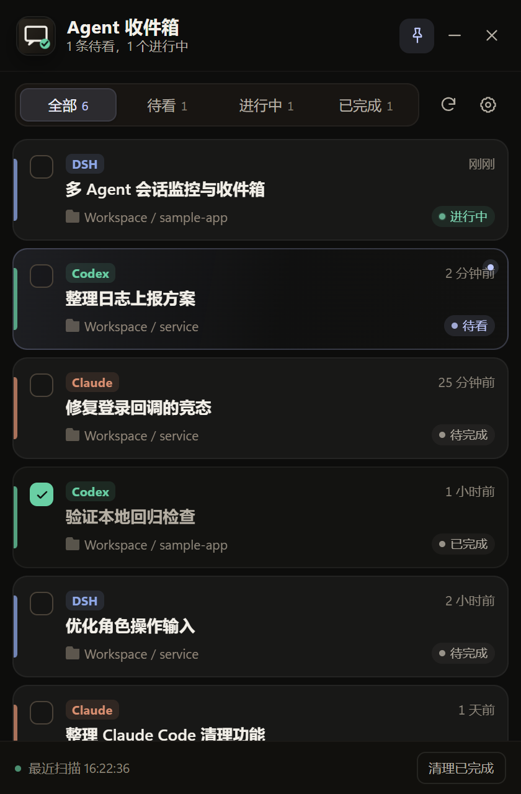
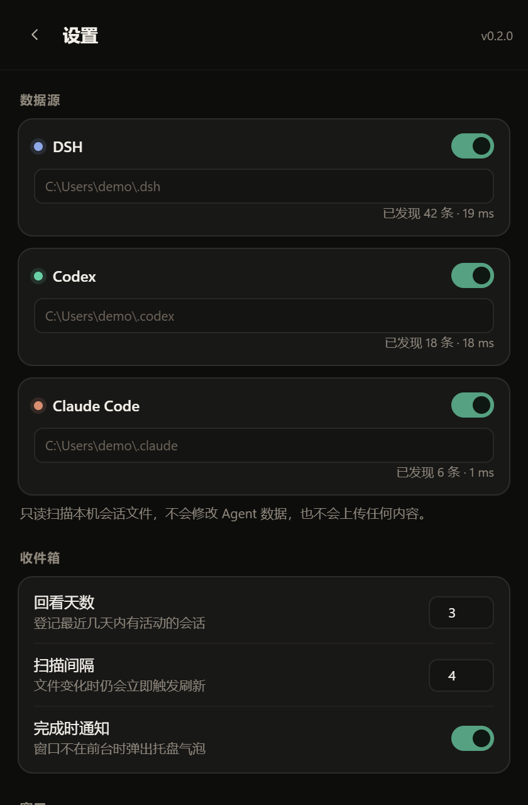

# 配色与界面设计说明

## 设计方向

Agent 收件箱是一个常驻桌面的小工具，不是营销页面。设计目标是：

- 像一张整理过的夜间工作台：暖、低眩光、安静；
- 信息密度高，但层级清楚；
- 来源色只做识别，不抢状态色；
- 所有状态都不只靠颜色表达。

因此放弃“近黑底 + 高饱和蓝/荧光绿”的通用 AI 深色壳，改为**暖石墨中性色 + 冷信号色**：

- 暖石墨负责背景、卡片、文字；
- 低饱和蓝紫 `--accent` 负责未读、焦点、主按钮；
- 薄荷绿负责运行中，琥珀负责中断，陶土色负责 Claude 来源；
- 来源色只出现在 3px 侧条和小徽标上。

## 参考的公开方法

| 来源 | 借用的方法 |
|---|---|
| [Anthropic frontend-design skill](https://github.com/anthropics/skills/blob/main/skills/frontend-design/SKILL.md) | 先定 4–6 个命名色；避免“近黑 + 单一荧光色”和 SaaS 卡片默认脸；克制装饰；一次只花一处大胆；用截图自检 |
| [UI UX Pro Max](https://github.com/nextlevelbuilder/ui-ux-pro-max-skill) | 语义 token、对比度检查、WPF/桌面端适配、把霓虹色和 AI 紫粉渐变列为 anti-pattern |
| [Vercel Web Interface Guidelines](https://github.com/vercel-labs/web-interface-guidelines) | 色相一致的边框/阴影；状态不能只靠颜色；hover/focus 对比度递增；`prefers-reduced-motion`；清晰焦点环 |
| [UI Skills](https://github.com/ibelick/ui-skills) | 把设计规范做成可复用的 agent skill / playbook，而不是一次性 prompt |

没有直接安装整套 skill；本次按其规则重写了 token 和局部样式。

## 色板

| Token | 值 | 用途 |
|---|---|---|
| `--bg` | `#0D0D0C` | 窗口底色 |
| `--panel` | `#181715` | 设置卡片、输入区 |
| `--panel-2` | `#201E1B` | 浮层、菜单 |
| `--line` | `#37332D` | 结构边框 |
| `--text` | `#F3F0E9` | 主文字 |
| `--muted` | `#B5AFA4` | 次级文字 |
| `--dim` | `#8F887C` | 时间、辅助信息 |
| `--accent` | `#C0CAFF` | 未读、焦点、主按钮 |
| `--green` | `#69CFA4` | 进行中 |
| `--amber` | `#E6B878` | 已中断 |
| `--red` | `#E88C84` | 危险操作 |
| `--dsh` | `#8FA8E8` | DSH 来源 |
| `--codex` | `#69CFA4` | Codex 来源 |
| `--claude` | `#D98F70` | Claude Code 来源 |

对比度（WCAG 2，按实际行背景 `#1B1A17` 计算）：

| 组合 | 比值 |
|---|---:|
| 主文字 / 背景 | 17.1:1 |
| 次级文字 / 背景 | 8.9:1 |
| 辅助文字 / 行背景 | 5.0:1 |
| 信号色 / 背景 | 10–12:1 |
| Claude 来源色 / 行背景 | 6.7:1 |
| DSH 来源色 / 行背景 | 7.4:1 |

## 具体规则

1. **一个主动 accent**：未读、焦点环、保存按钮用同一种低饱和蓝紫；不再用蓝色渐变洗背景。
2. **来源色只做身份**：3px 左侧色条 + 小徽标，不铺整行背景。
3. **状态文字化**：进行中 / 待看 / 待完成 / 已完成 / 已中断都有文字，不只靠圆点颜色。
4. **完成不等于不可读**：已完成的记录降低底色、标题转次级色，不再把整行 opacity 压到 0.5。
5. **边框和阴影同色相**：暖灰边框配暖黑阴影，不用冷蓝阴影破坏色温。
6. **去掉全大写标签**：`CODEX` → `Codex`，减少模板感。
7. **动效克制**：只保留进行中呼吸点、toast、hover 状态变化；支持 `prefers-reduced-motion`。
8. **焦点可见**：按钮、开关、行都有 `:focus-visible` 焦点环。

## 被放弃的方案

- **近黑 + 荧光绿**：常见的 AI/终端默认脸，和来源色冲突。
- **蓝色 SaaS 渐变**：背景渐变、蓝色主按钮、蓝色高亮一起使用，层级反而模糊。
- **全行低透明度表示完成**：看起来干净，但小字对比度不足。
- **只换主色**：不调整表面、边框、文字与完成状态，整体仍会显得像模板。
